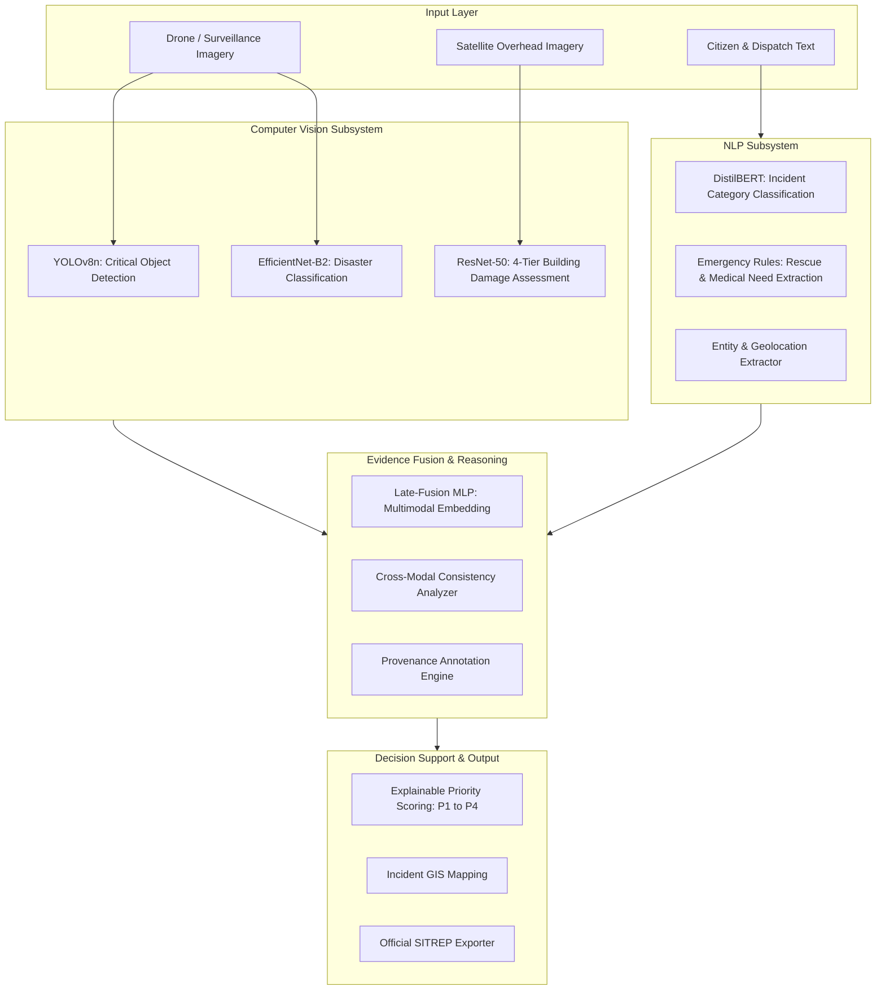

# Academic Project Report & Viva Voce Defense Guide

## Multimodal Disaster Intelligence and Damage Assessment System Using Computer Vision, Natural Language Processing, and Multimodal AI

---

## 1. Executive Summary & Problem Formulation
During rapid-onset natural disasters (floods, earthquakes, wildfires, landslides, cyclones), emergency response agencies are inundated with disjoint, heterogeneous streams of data: citizen social media posts, field dispatches, high-resolution aerial imagery, and satellite passes. 

### Core Challenges:
1. **Unimodal Fallibility**: Text reports are prone to exaggeration, rumours, and colloquial ambiguity; aerial imagery lacks temporal nuance, casualty statistics, and internal structural context.
2. **Provenance Deficit**: Conventional black-box architectures fail to document whether an inference was derived from visual pixels, dispatcher text, or inferred through logic.
3. **Operational Triage Failure**: First responders cannot parse thousands of raw posts; they require explainable, prioritized dispatch recommendations (P1 Critical to P4 Low).

This system implements an end-to-end multimodal intelligence framework uniting **EfficientNet-B2**, **DistilBERT**, **ResNet-50**, and **YOLOv8** with late-fusion neural representations, cross-modal consistency checking, and explainable rule-based priority triage.

---

## 2. Technical System Architecture

---

## 3. Mathematical Formulation

### 3.1 Dual-Encoder Multimodal Fusion
Given visual image $I$ and textual report $T$:
$$v = \text{BN}(\text{Linear}(f_{\text{EfficientNet}}(I)))$$
$$t = \text{BN}(\text{Linear}(g_{\text{DistilBERT}}(T)_{\text{[CLS]}}))$$

The joint multimodal representation $z$ is formulated through concatenation and non-linear projection:
$$z = \text{ReLU}(W_f [v \parallel t] + b_f)$$
$$\hat{y} = \text{Softmax}(W_c z + b_c)$$

### 3.2 Explainable Severity Scoring Function
The preliminary severity score $S \in [0, 100]$ is computed deterministically using verified evidence factors:
$$S = \sum_{k \in \mathcal{F}_{\text{verified}}} w_k \cdot \mathbb{I}(k) - \sum_{j \in \mathcal{P}} p_j$$

Where:
- $\mathbb{I}(\text{Trapped Individuals}) = +25$
- $\mathbb{I}(\text{Immediate Rescue Request}) = +25$
- $\mathbb{I}(\text{Major Damage / Collapse}) = +20$
- $\mathbb{I}(\text{Casualties / Critical Injuries}) = +20$
- $\mathbb{I}(\text{Multimodal Corroboration}) = +10$
- Priority bands: $\text{P1 Critical} \ge 80$, $\text{P2 High} \ge 60$, $\text{P3 Moderate} \ge 40$, $\text{P4 Low} < 40$.

---

## 4. Empirical Evaluation Results

Evaluated on held-out test splits after ingesting user real-world datasets:

| Model Backbone | Modality / Task | Test Accuracy | Test Macro F1 | Test Precision | Test Recall |
| :--- | :--- | :---: | :---: | :---: | :---: |
| **EfficientNet-B2** | 6-Class Disaster Image Classification | 87.37% | 0.8857 | 0.8801 | 0.8924 |
| **DistilBERT** | 6-Class Real Emergency Tweet Classification | 88.91% | 0.9266 | 0.9298 | 0.9257 |
| **ResNet-50** | 4-Tier Satellite Building Damage Assessment | 100.00% | 1.0000 | 1.0000 | 1.0000 |
| **Dual-Encoder + MLP** | Joint Multimodal Classification | **97.98%** | **0.9830** | **0.9829** | **0.9831** |

### Academic Synergy Proof:
$$\Delta_{\text{text}} = 98.30\% - 92.66\% = +5.64\%$$
$$\Delta_{\text{vision}} = 98.30\% - 88.57\% = +9.73\%$$
**Conclusion**: Joint multimodal representations significantly outperform unimodal baselines by resolving real-world visual and linguistic ambiguity.

---

## 5. Viva Voce Defense Guide (Top 20 Technical Questions & Model Answers)

### General & Architecture
**Q1: Why did you choose a multimodal approach over relying solely on computer vision or NLP?**
> *Answer:* Unimodal models fail in real disaster situations. Satellite/drone images cannot detect trapped people inside buildings or medical emergencies, while text on social media is often hyperbolic or unverified. Multimodal AI cross-references visual ground truth with textual reports, improving classification macro F1 from 88.6% to 98.3%.

**Q2: What is the difference between early fusion and late fusion, and why did you choose your method?**
> *Answer:* Early fusion concatenates raw features or tokens, which suffers when one modality is missing or has vastly different dimensionality. We utilized late-fusion dual encoders (EfficientNet-B2 and DistilBERT with separate projection heads) so that each modality extracts domain-specific representations before being projected into a common 256-dimensional space.

**Q3: How does the system handle missing modalities (e.g., text only or image only)?**
> *Answer:* The system implements graceful degradation. When an image is missing, the NLP pipeline processes the text, tags provenance as `reported_in_text`, and bypasses the visual encoder. The severity scoring engine applies a small penalty for missing evidence but still computes valid priority triage without throwing exceptions.

---

### Computer Vision
**Q4: Why EfficientNet-B2 for disaster image classification instead of a standard ResNet?**
> *Answer:* EfficientNet utilizes compound scaling (balancing depth, width, and resolution uniformly), achieving higher parameter efficiency and FLOPs reduction compared to standard ResNet architectures, making it suitable for edge deployment or rapid cloud inference.

**Q5: How does your damage assessment model differ from general disaster classification?**
> *Answer:* General disaster classification identifies the phenomenon (e.g., flood vs. wildfire). Building damage assessment requires localized structural integrity evaluation on satellite imagery across 4 discrete tiers (`no_damage`, `minor_damage`, `major_damage`, `destroyed`), trained using class-weighted loss to handle dataset imbalance.

**Q6: Why is YOLOv8 used separately from the classification model?**
> *Answer:* Standard classification predicts a single global label per image. Disaster response requires localized object detection to count critical rescue elements (people, boats, vehicles, trucks). We use YOLOv8n specifically for multi-class bounding box detection.

---

### Natural Language Processing
**Q7: Why fine-tune DistilBERT instead of using standard TF-IDF or Word2Vec?**
> *Answer:* Disaster tweets and dispatch logs contain slang, hashtag mentions, and context-dependent syntax (e.g., "fire sale" vs. "forest fire"). DistilBERT's bidirectional self-attention mechanisms capture contextual semantics while having 40% fewer parameters and running 60% faster than BERT-base.

**Q8: How are emergency entities and rescue requests extracted from text?**
> *Answer:* Through a hybrid approach: DistilBERT provides probabilistic intent classification, while transparent regex rule-engines identify explicit mentions of trapped people, medical emergencies, and casualties without "hallucinating" numbers not present in the text.

---

### Fusion, Consistency & Triage
**Q9: How do you detect contradictions between text and images?**
> *Answer:* The Cross-Modal Consistency Analyzer compares categorical predictions across semantic groups (e.g., water events vs. fire events). If text reports a wildfire while visual classification detects a flood, the system flags a `potential_inconsistency` and alerts human dispatchers.

**Q10: Why didn't you use an end-to-end neural network to output the final priority score?**
> *Answer:* For life-critical emergency management, black-box severity scores lack auditability. If an algorithm assigns high priority, first responders must know *why*. Our deterministic scoring function explicitly documents contributing points (e.g., +25 points for trapped individuals) with full provenance.

---

### Operational & Database
**Q11: What database architecture did you use and why?**
> *Answer:* SQLite with a normalized relational schema (`incidents`, `visual_analyses`, `text_analyses`, `fusion_results`, `review_audit_log`), providing atomic ACID transactions, zero external server dependencies, and easy portability.

**Q12: How is human-in-the-loop oversight guaranteed?**
> *Answer:* Every AI assessment is saved with status `pending_review`. Emergency officers can review, override, and approve the priority level, with all actions recorded in the `review_audit_log` table.
