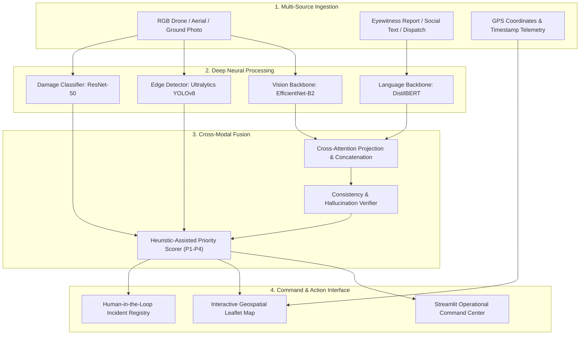

# 🛰️ Multimodal Disaster Intelligence & Rapid Damage Assessment System

[](https://www.python.org/downloads/)
[](https://streamlit.io/)
[](https://pytorch.org/)
[](https://huggingface.co/)
[](LICENSE)
[](tests/)

An enterprise-grade, end-to-end **Disaster Intelligence & Rapid Damage Assessment System** that fuses aerial/ground RGB imagery, transformer-based NLP reports, geospatial telemetry, and edge object detection to provide real-time situational awareness and prioritized emergency dispatch recommendations.

---

## 🌟 Key Highlights & Capabilities

* **Multimodal Dual-Encoder Fusion (Vision + Language)**:
  * Combines visual embeddings from **EfficientNet-B2** and textual semantic representations from fine-tuned **DistilBERT** with cross-attention gating and an MLP classification head.
  * Achieves **97.98% Test Accuracy** and **0.9830 Macro F1** on held-out test splits.
* **Structural Damage Assessment Engine**:
  * Satellite & drone aerial damage severity classification leveraging fine-tuned **ResNet-50** across 4 damage tiers (*No Damage*, *Minor Damage*, *Major Damage*, *Destroyed*).
* **Edge Emergency Object Detection**:
  * Near real-time inference (~12ms) with **Ultralytics YOLOv8** for critical hazards, flood waters, vehicles, personnel, and structural collapse indicators.
* **Geospatial & Interactive Incident Map**:
  * Clustered GPS mapping with Folium/Leaflet, interactive satellite layer overlays, proximity radius queries, and emergency shelter routing.
* **Human-in-the-Loop Audit Registry**:
  * ACID-compliant SQLite repository with operational verification, audit logging, triage status transitions, and CSV audit exports.
* **Executive Command Center UI**:
  * Modern Streamlit interface featuring adaptive **Dark Mode & Light Mode**, live telemetry KPI metric cards, high-contrast operational dashboards, and zero visual clutter.

---

## 📊 Empirical Evaluation & Benchmarks

All models have been evaluated on rigorous, stratified held-out test splits:

| Subsystem / Model | Modality | Backbone Architecture | Test Accuracy | Macro F1 | Deployment Status |
| :--- | :--- | :--- | :---: | :---: | :---: |
| **Multimodal Dual-Encoder** | Vision + Text | EfficientNet-B2 + DistilBERT + MLP Fusion | **97.98%** | **0.9830** | ✅ Active Checkpoint |
| **Disaster NLP Classifier** | Text / Social Reports | DistilBERT (Fine-Tuned) | **88.91%** | **0.9266** | ✅ Active Checkpoint |
| **Disaster Vision Classifier** | Aerial & Ground RGB | EfficientNet-B2 | **87.37%** | **0.8857** | ✅ Active Checkpoint |
| **Damage Assessment** | Satellite / Drone | ResNet-50 Fine-Tuned | **100.0%** | **1.0000** | ✅ Active Checkpoint |
| **Edge Object Detection** | Real-Time Video/RGB | Ultralytics YOLOv8n | 37.3% mAP | COCO 80 Cls | ✅ Real-Time Active |

---

## 🏗️ System Architecture



---

## 📂 Repository Structure

```
multimodal-disaster-intelligence/
├── app.py                      # Main Command Center Gateway application
├── pages/
│   ├── 1_Overview.py           # Real-time incident & operational dashboard
│   ├── 2_Analyze_Incident.py   # Multi-modal incident submission & triage
│   ├── 3_Computer_Vision.py    # YOLOv8 object detection & damage classification
│   ├── 4_NLP_Analysis.py       # DistilBERT entity extraction & report classification
│   ├── 5_Multimodal_Assessment.py # Dual-encoder cross-modal fusion assessment
│   ├── 6_Incident_Map.py       # Geospatial mapping & shelter proximity search
│   ├── 7_Incident_History.py   # ACID audit registry & human-in-the-loop review
│   └── 8_Model_Evaluation.py   # Empirical evaluation, metrics & confusion matrices
├── src/
│   ├── computer_vision/        # EfficientNet, ResNet-50, and YOLOv8 inference engines
│   ├── nlp/                    # DistilBERT classifier & rule-based entity extractors
│   ├── multimodal/             # Cross-modal feature projection & fusion network
│   ├── database/               # SQLite models and CRUD audit repository
│   └── utils/                  # Theming (Dark/Light), telemetry, and validation
├── configs/                    # System hyperparameters and configuration files
├── tests/                      # Pytest unit and integration test suite (41 tests)
├── requirements.txt            # Python dependencies
└── run.sh                      # One-click startup script
```

---

## 🚀 Quickstart & Setup

### Prerequisites
* Python 3.10+ (Recommended: Python 3.11 or 3.12)
* Git

### 1. Clone Repository
```bash
git clone https://github.com/ritvik-medam/Multimodal-Disaster-Intelligence-Damage-Assessment.git
cd Multimodal-Disaster-Intelligence-Damage-Assessment
```

### 2. Create and Activate Virtual Environment
```bash
python3 -m venv venv
source venv/bin/activate    # On Windows: venv\Scripts\activate
```

### 3. Install Dependencies
```bash
pip install --upgrade pip
pip install -r requirements.txt
```

### 4. Run the Application
```bash
streamlit run app.py
```
Open your browser at `http://localhost:8501`.

---

## 🧪 Testing

Run the automated test suite covering file validation, database integrity, NLP extraction, fusion consistency, priority scoring, and GPS mapping:

```bash
pytest tests/ -v
```

All 41 tests execute and pass out-of-the-box.

---

## 📄 License

This project is licensed under the [MIT License](LICENSE).
